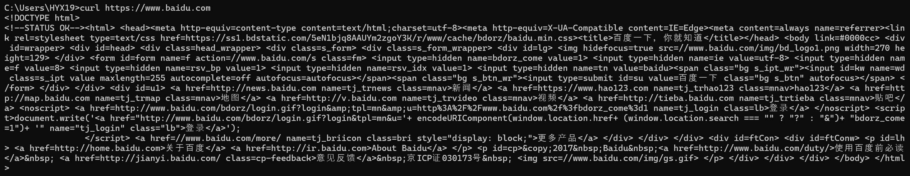
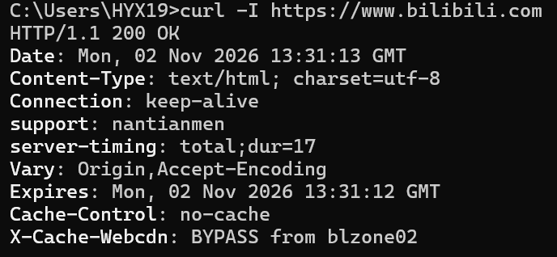
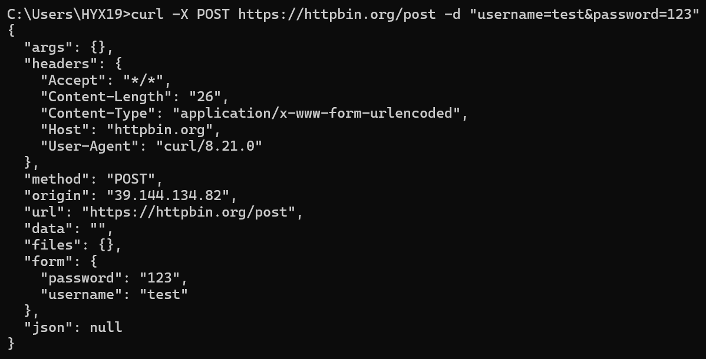
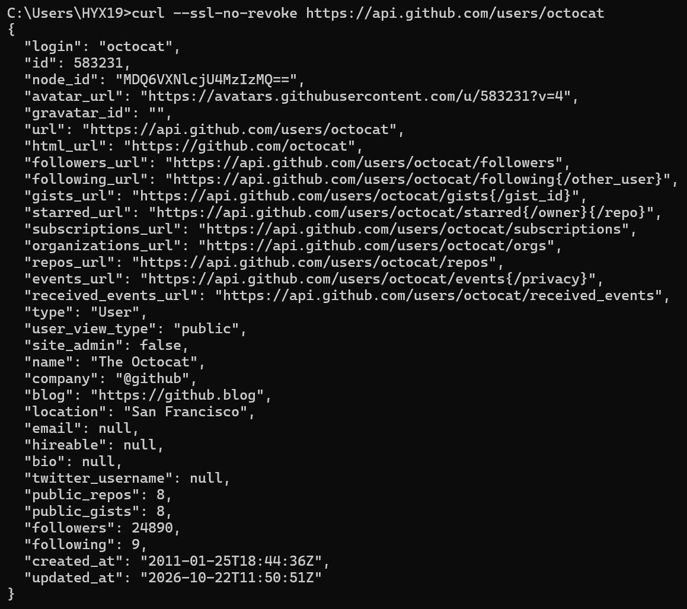

--使用curl --version查看版本   
    

--获取网页内容  
使用curl https://www.baidu.com命令  
    

--获取 HTTP 响应头  
使用curl -I https://www.bilibili.com命令  
    

--带参数的 POST 请求  
使用 httpbin.org 这个测试网站  
命令为curl -X POST https://httpbin.org/post -d "username=test&password=123"  
    

--测试公开的 API 并格式化输出  
使用curl -s https://api.github.com/users/octocat命令  
    
