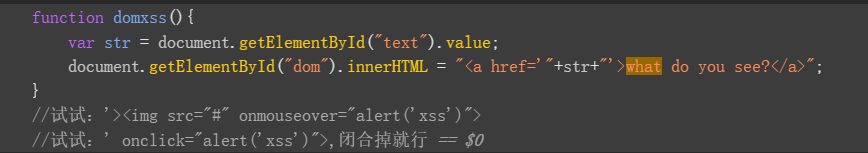
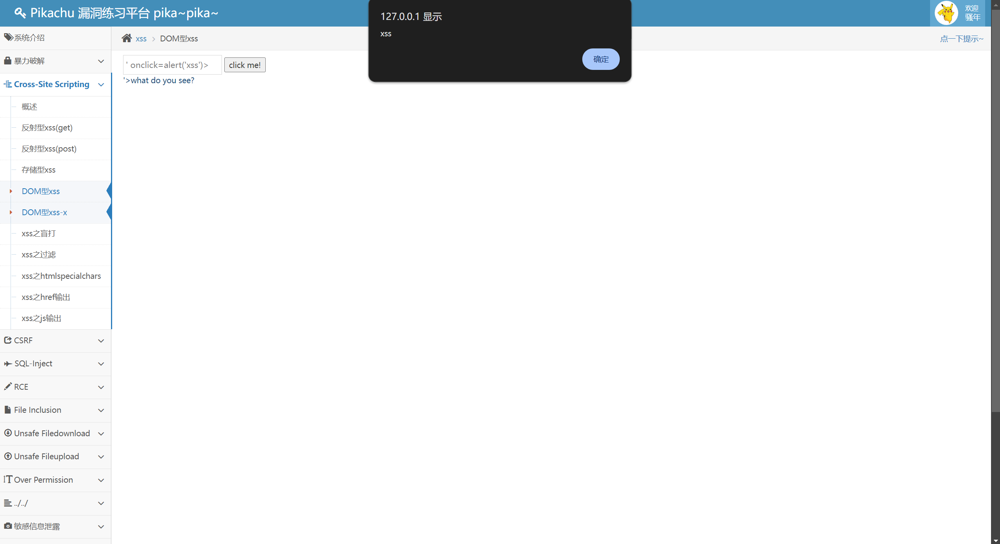

按下F12可以看到如下代码  
  
<a href='"+str+"'>what do you see?</a> 输入的内容会被传到str里面  
若在框中输入' onclick=alert('xss')>  
整条代码就会变成<a href='' onclick=alert(‘xss’)>'>what do you see?</a>  
href=''，href的属性的值就变成了空  
接着就是onclick=alert('xss')，浏览器现在认为 href 属性已经结束了  
接下来是标签的下一个属性。它看到了 onclick，于是把这段 JS 代码绑定到了“点击事件”上  
此时点击what do you see?  
便可以看到一个xss的弹窗  
  
