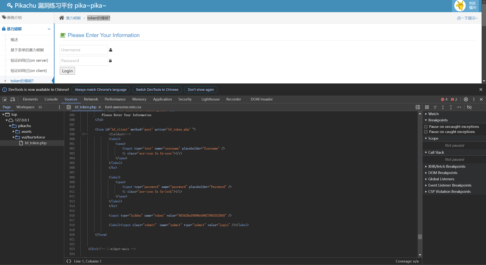
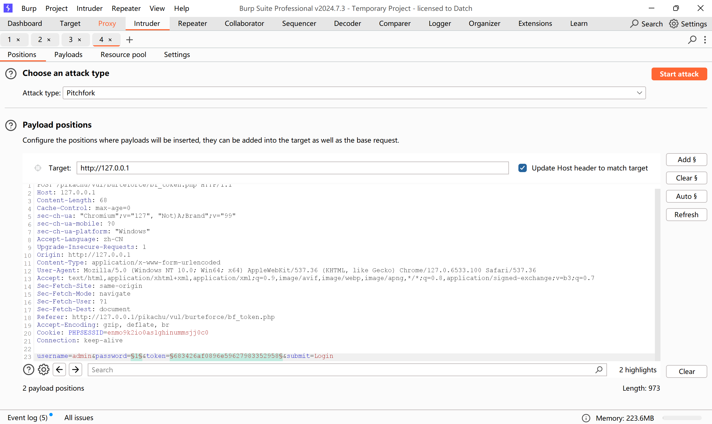
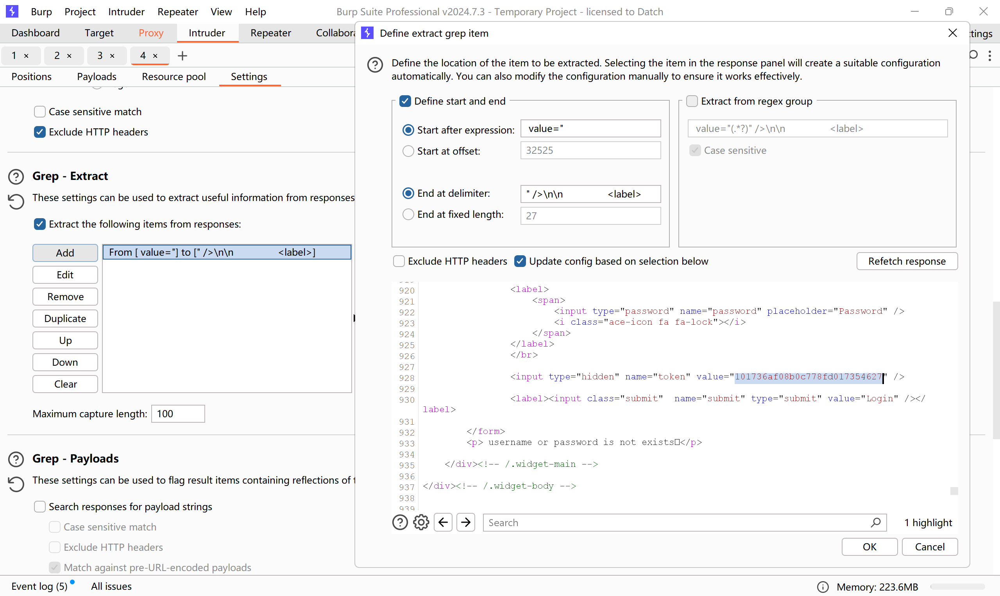
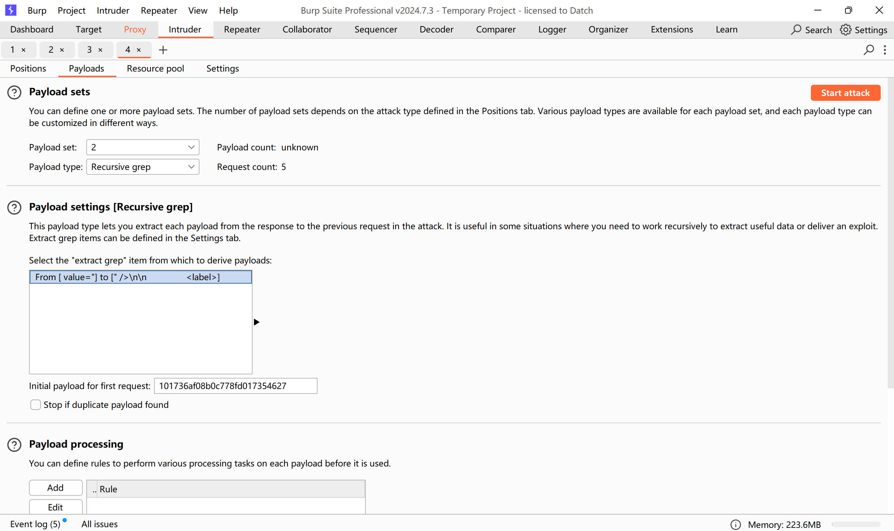

先F12检查，在密码框代码的下边，发现进行验证的token  
  
对于有token的的验证，适用于已经知道账号的情况，或者账号和密码一一对应的情况  
攻击目标选择password以及token，攻击方式选择Pitchfork    
  
来到payloads模块,password设置和之前一样，上传爆破字典  
接着来到Settings模块，往下滑找到Gerp-Extract  
点击add，接着选中token  
  
再回到payloads模块，在第二个位置处选择Secursive grep，并将token粘贴到下面的框里  
  
开始攻击即可
