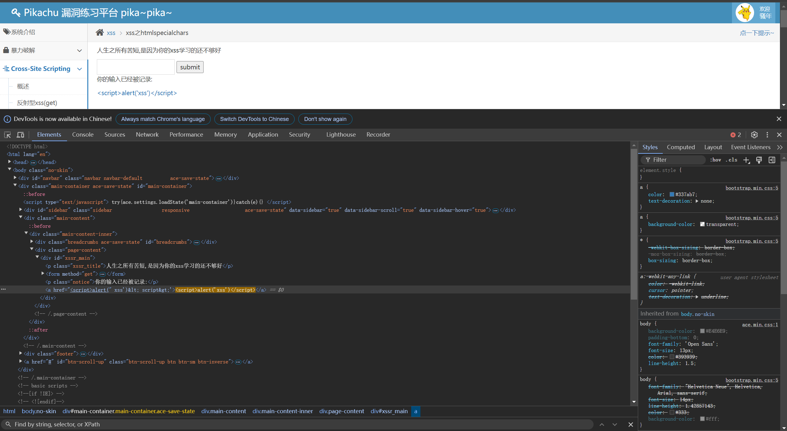

htmlspecialchars()是PHP后端开发中一个极其重要的内置函数，核心作用是转义。  
其将危险符号，替换成安全的实体字符  

-----------------------------------------------------------------------

在框内输入，点击submit后无弹窗  
按F12查看elements  
发现里面的内容已经被转换
   
herf后面为单引号闭合，所以alert里面要使用双引号   
输入javascript:alert("xss")来构建payload，点击submit后出现弹窗  

输入' onclick='alert("xss")来构建payload，点击后出现弹窗  
第一个单引号用来闭合href的内容，第二个单引号刚好与后面自带的单引号完成闭合，从而来执行alert("xss")  
