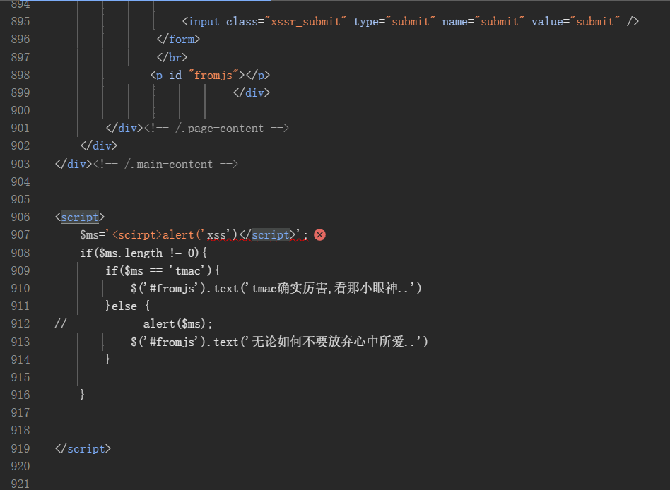

输入<scirpt>alert('xss')</script>提交后无反应  
查看sources发现其后提交  
其弹出警告弹窗  

输入';alert(`xss`);//后其出现弹窗  
第一个引号闭合了原本包裹变量的单引号  
第一个分号结束了原本的赋值语句 $ms='';  
第二个分号结束alert语句  
//把后端原本自带的那个结尾单引号（以及后面的代码）给注释掉了，防止页面报错
