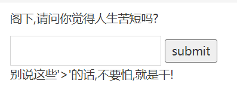

在框内输入，点击submit  
  
发现只输出了一个">"  
表明其开启了过滤  

输入来构建payload，点击submit  
其弹出了xss的警告弹窗  
浏览器去请求一个地址为1的图片，失败时(onerror)即触发alert  
2.png)  

输入,点击submit  
其弹出了xss的警告弹窗  
表明其只过滤了小写的script，使用大写SCRIPT依旧可以触发xss漏洞  

输入<svg onload=alert('xss')>，点击submit  
其弹出了xss的警告  
SVG（Scalable Vector Graphics）标签。它是 HTML5 中引入的合法标签，用于在网页里直接画图。
当浏览器解析并成功渲染了这个<svg>标签后，就会触发这个onload。  
之后就会弹出xss警告  
