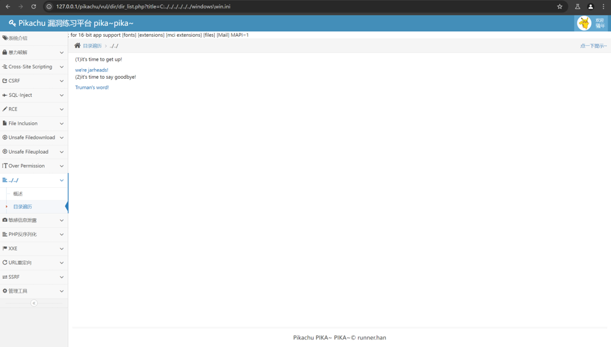

点击we're jarheads!，url的内容变为http://127.0.0.1/pikachu/vul/dir/dir_list.php?title=jarheads.php  
点击Truman's word!，url的内容变为http://127.0.0.1/pikachu/vul/dir/dir_list.php?title=jarheads.php  
修改最后的title为C:../../../../../../windows\win.ini  
成功访问到了win.ini文件  
  
